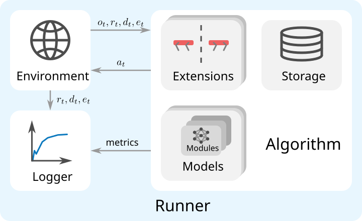
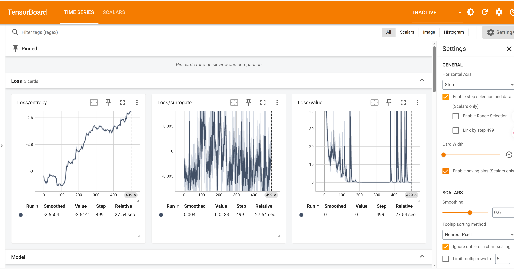
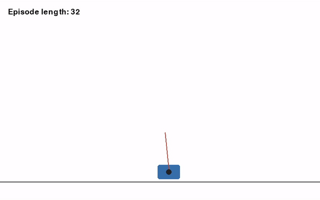

# 从零入门强化学习实践-用rsl_rl训练一个倒立摆模型
## 零、前言

这篇文章面向刚开始学习 rsl-rl、希望弄清楚训练脚本如何串起环境、策略和算法的读者。文章从 rsl-rl 官方文档中的 Runner 训练流程出发，实现一个简化的一阶倒立摆环境，再依次讲解 VecEnv 接口、TensorDict 观测、PPO 配置、Runner.learn()、训练日志和 Pygame 可视化。示例按代码执行顺序展开，重点解释环境状态的形状、step() 的返回值、配置项如何被 Runner 使用，以及动作和奖励如何进入训练循环。

与许多直接建立在 Isaac Lab、MuJoCo 等仿真器上的实践教程相比，本文先不引入外部物理仿真平台，而是在环境中显式计算倒立摆的非线性动力学。这样可以把注意力放在 rsl-rl 的环境接口和训练主循环上，并直接看到动作如何改变状态、奖励如何返回、超时信息如何传递。代价是这个教学环境只包含简化的刚体模型和基础复位逻辑，不能代替成熟仿真器中的接触、摩擦、传感器或机器人模型。完成本例后，读者可以把已理解的交互接口迁移到真实仿真环境。

本文关注的是如何把一个最小环境接入 PPO 并运行训练，不以完整介绍强化学习理论、所有 rsl-rl 配置项或部署流程为目标。物理推导、代码实现与可视化章节各自对应独立步骤，读者可以先跑通示例，再按需要深入相应部分。

由于当前rl相关知识更新速度快，各位学习时应注意版本。此文写自2026.11，rsl_rl版本为v6.0.0，python版本为3.9

rsl_rl github：https://github.com/leggedrobotics/rsl_rl

rsl_rl 官方数据手册：https://leggedrobotics.github.io/rsl_rl/guide/installation.html

本教程的源码与md文件可以从

https://github.com/vod-x/rl-learn

获取，如果这个教程对你有帮助，一个star将会是对我莫大的支持
## 一、安装rsl_rl
根据rsl_rl[官方数据手册](https://leggedrobotics.github.io/rsl_rl/index.html)安装说明，使用conda创建一个python版本为3.9的虚拟环境，这里将虚拟环境命名为rsl_rl
```bash
conda create --name rsl_rl python=3.9
```
激活conda环境：
```bash
conda activate rsl_rl
```
在conda环境下执行如下命令，从远程仓库克隆rsl_rl库，并安装所需依赖。
```bash
git clone https://github.com/leggedrobotics/rsl_rl
cd rsl_rl
pip install -e .
```

##  二、如何使用rsl_rl
在其[官方数据手册](https://leggedrobotics.github.io/rsl_rl/guide/overview.html)中的overview一栏，给出了rsl_rl训练的伪代码：
```python
import yaml

from rsl_rl.runners import OnPolicyRunner

# 1) Create your environment (usually provided by environment libraries such as Isaac Lab)
env = make_env()

# 2) Load a YAML configuration and extract the configuration dictionary expected by RSL-RL
with open("config/my_training.yaml", "r", encoding="utf-8") as f:
    full_cfg = yaml.safe_load(f)
train_cfg = full_cfg["runner"]

# 3) Build the runner
runner = OnPolicyRunner(
    env=env,
    train_cfg=train_cfg,
    log_dir="logs/my_experiment", # Directory for saving checkpoints and logs
    device="cuda:0", # Device to run the training on
)

# 4) Start training
runner.learn(num_learning_iterations=1500) # Specify the number of desired iterations

# 5) Export the trained policy for deployment
runner.export_policy_to_jit("logs/my_experiment/exported", filename="policy.pt")
runner.export_policy_to_onnx("logs/my_experiment/exported", filename="policy.onnx")
```
除此之外没有其他额外的说明，仅有一些对api接口的描述。本着实践是最好的学习的原则，本篇教程将从这个伪代码开始，逐行训练一个一阶倒立摆

粗略阅读上述代码，不难发现其由如下几个部分组成：1）创建环境，2）导入配置，3）创建训练器（runner），4）使用训练器训练，5）导出训练器结果，方便回放。为了搞明白这个代码在干什么，下面将简要说明一下rsl_rl的设计理念。

### 2.1、runner

runner是rsl_rl算法库的核心部分，也是主要api。大部分情况下，使用rsl_rl，都是通过runner类下的方法与rsl_rl交互。runner实现了 learn() 中的主学习循环，并协调与环境之间的交互。通过 save() 、 load() 、 export_policy_to_jit() 和 export_policy_to_onnx() 提供保存、加载和导出检查点与模型的功能。此外，它还协调多 GPU 管线、算法和 Logger 的初始化。rsl_rl提供了OnPolicyRunner，OffPolicyRunner,，DistillationRunner三种不同类型的runner，三者的不同点在于更新策略时使用的算法不同，但核心设计理念相同。作为入门，我们从最常用的OnPolicyRunner入手。


为了弄懂runner在干什么，先回顾一下，一步(step)标准的rl训练包含如下几个步骤：1）从环境(environment)中进行观测，获取观测量(observation)->2）将观测量传递给当前策略(policy)，策略输出行动(action)->3）将行动传给智能体(agent),智能体执行动作，与环境交互，改变自身的状态(state)->4)通过state的变化评价其行为，生成奖励(reward)->5)用奖励的大小，奖励的变化等一系列信息改进策略->6）继续从环境观测，用改进完的策略进行下一轮训练。伪代码如下：
```python
# 训练1000步
for i in range(1000):
    # 从环境中获取观测值
    obs = env.get_obs()
    # 策略根据观测值输出行为
    act = policy(obs)
    # 智能体执行行为，与环境交互，环境变化，从中获取奖励与状态量
    reward, state = env.step(obs)
    # 根据奖励与状态改进行为
    policy = policy_improve(reward, state)
```
runner由下图几个部分组成



其中extensions是一些额外的功能，暂时不需要管。不难发现，runner其实就是将上述的伪代码进行了封装。

点开最常用的onpolicyrunner的[函数声明](../rsl_rl/runners/on_policy_runner.py#26)

```python
class OnPolicyRunner:
    def __init__(self, env: VecEnv, train_cfg: dict, log_dir: str | None = None, device: str = "cpu") -> None:
```
其要求传入这几个参数：

`env`：一个继承自VecEnv的子类，实现观测，环境交互等功能

`train_cfg`：配置文件，定义了网络结构，学习率等rl训练中的可配置部分，dict类型，也可以像上面的官方示例一样由yaml转化而来

`log_dir`：日志存贮路径

`device`：计算要在哪个设备上运行，通常选择cpu或是gpu

当传入这些参数后，只要再调用其自身的方法[train()](../rsl_rl/runners/on_policy_runner.py#56)，就可以完成一次训练。

### 2.2、env
env是我们自定义的，一个继承自[VecEnv](../rsl_rl/env/vec_env.py)的类，其声明为：

```python

# ABC即ABstrac Class(抽象类)，VecEnv继承自这个类是为了使用修饰器@abstracmethod，组织类被直接实体化
# 这里Vec意为Vector，即向量化的类，在实际训练过程中，为了训练效率和gpu利用率，一次训练中常常会有多个环境同时训练。而向量化环境意味着这个环境可以接受一个向量形的action，并生成一个向量形的observation
class VecEnv(ABC):

    # 创建环境的个数
    num_envs: int

    # 单个环境下有多少动作输入
    num_actions: int

    # 一轮(episode)训练最多持续多少步(step),这里的类型为int或是tensor，当为标量时，其对所有环境都适用，为张量时，可以为每个环境配置不同的最大步数
    max_episode_length: int | torch.Tensor

    # 当前所有环境的训练步数
    episode_length_buf: torch.Tensor

    # 使用哪个设备
    device: torch.device | str

    # 环境配置，可以用于记录一些自定义的数据，如当前环境的版本，一些物理参数的设置等，在runner训练时会将其存储至logger中
    cfg: dict | object

    # @abstractmethod抽象方法装饰器，带有此装饰器的方法必须在子类中重写，子类才能正常实例化
    @abstractmethod
    # 获取观测值的方法，在子类中重写
    def get_observations(self) -> TensorDict:
        # 占位用，表示这个方法还没有实现，如果执行了这个还没有实现的方法，则会抛出错误
        raise NotImplementedError

    @abstractmethod
    # action作用于env的方法，在子类重写
    # 输入为actions，张量
    # 返回为有观测量，奖励，是否完成，额外数据所构成的元组
    def step(self, actions: torch.Tensor) -> tuple[TensorDict, torch.Tensor, torch.Tensor, dict]:
 
        raise NotImplementedError
```
阅读源码，可以看出，env的作用是提供一个抽象的接口。而我们在使用rsl_rl时，需要根据自己的许求，示例化这个env，并在env中实现get_observation()与step()两个方法，具体如何实现将在接下来的章节结合例子进行讲解。

### 2.3、config
这里的config指传入runner中的config，要与env中的config区分开。其是一个字典类型的变量，也可以由yaml这种专门用于配置文件的语言导入，作为入门教程，这里仅介绍基础的dict写法。

dict(字典)，是python中存储键值对的变量类型，并且可以通过键对对应的值进行索引，写法如下：
```python
dictname = {"键"：值}
```
值可以是字符串，整形，浮点等类型，也可以是dict类型，实现嵌套。

rsl_rl中提供了丰富的config可选项，这里不一一赘述，各位在需要使用时可以在[官方手册](https://leggedrobotics.github.io/rsl_rl/guide/configuration.html#)中自行查询，这里仅给出实现一个PPO OnPolicyRuneer时必须配置的config作为参考

```python
train_cfg = {
    # 每次 PPO 更新前，每个环境采集多少步
    "num_steps_per_env": 32,
    # 每隔多少次训练迭代保存 checkpoint。日志开启时需要提供
    "save_interval": 100,
    # 指定 actor 和 critic 分别读取 TensorDict 中哪些键。这里假设观测包含 obs["policy"]
    "obs_groups": {
        "actor": ["policy"],
        "critic": ["policy"],
    },
    # 指定算法类。PPO 的其他参数，例如 learning_rate、gamma、num_learning_epochs，都有默认值，可以按需覆盖。
    "algorithm": {
        # 算法名称, 必填
        "class_name": "PPO",
    },
    # actor 模型配置项
    "actor": {
        # 模型类名称 必填
        "class_name": "MLPModel",
        # 分布配置
        "distribution_cfg": {
            # 分布类名称 必填
            "class_name": "GaussianDistribution",
        },
    },
    # critic 模型配置项
    "critic": {
        # 模型类名称
        "class_name": "MLPModel",
    },
}
```
## 三、动手写一个训练脚本
通过第二章的介绍，你可能已经对rsl_rl的训练过程有了一个模糊的认知：
```
只要根据自己想要训练的模型，配置好env，并实现`step()`和`get_observation()`方法，在选择自己要用什么算法，算法中哪些配置项需要更改，将其写成一个config。再把env和config扔给runner，调用runner.learn()，等待一段实践，就可以从runner中拿到目标的policy了。
```

那么，就以此为基础，写一个倒立摆训练脚本吧。

### 3.0、新建文件
在rsl_rl的根目录下创建一个`cartpole.py`文件，它的路径会影响后续相对路径的编写，务必和我保持一致，不要放到rsl_rl/rsl_rl中了，现在项目的大致结构为：
```
rsl_rl
├── AGENTS.md
├── cartpole.py # 脚本文件
├──  ......
├── rsl_rl # rsl_rl源码
├──  ......
```
### 3.1、倒立摆的物理模型
在真正的rl训练中，agent如何与环境进行交互，如何从环境中获取反馈量，agent自身的state如何变化，这些计算一般都由isaacsim，mujuco这类物理仿真平台自动计算完成，我们训练时需要什么变量，通过仿真平台提供的api直接获取就行。而安装isaacsim，mujuco等仿真平台又要捣鼓一段时间，还要考虑驱动，版本，依赖，api使用等一系列问题，为了聚焦于rsl_rl本身，这里不做具体讲解，直接给出结果。

详细推导可以参考我的另一篇文章：

注意一下各符号的定义，方向和零点，后续直接把这个模型带入env就行。

符号定义如下
$$
\begin{array}{c|c|c}
\hline
\text{物理意义} & \text{符号} & \text{正方向}\\
\hline
\text{摆杆质量} & m & -\\
\text{小车质量} & M & -\\
\text{摆杆绕质心的转动惯量} & I_G & -\\
\text{摆杆质心到转轴距离} & l & -\\
\text{小车x方向坐标} & x & \text{水平向右}\\
\text{小车y方向坐标} & y & \text{竖直向上}\\
\text{摆杆x方向坐标} & x_p & \text{水平向右}\\
\text{摆杆y方向坐标} & y_p & \text{竖直向上}\\
\text{小车速度} & \dot{x} & \text{水平向右}\\
\text{小车加速度} & \ddot{x} & \text{水平向右}\\
\text{摆杆角度} & \theta & \text{逆时针}\\
\text{摆杆角速度} & \dot{\theta} & \text{逆时针}\\
\text{摆杆角加速度} & \ddot{\theta} & \text{逆时针}\\
\text{小车所受推力} & F & \text{水平向右}\\
\text{摆杆所受小车的竖直力} & P & \text{竖直向上}\\
\text{小车受摆杆的竖直力} & P' & \text{竖直向上}\\
\text{摆杆所受小车的水平力} & N & \text{水平向右}\\
\text{小车受摆杆的水平力} & N' & \text{水平向右}\\
\hline
\end{array}
$$

其中，摆杆竖直向上时，$\theta=0$

此模型的输入为$[F]$

状态量为$[x,\dot{x},\theta,\dot{\theta}]$

观测量也为$[x,\dot{x},\theta,\dot{\theta}]$，是一个全状态观测

$$
\begin{aligned}
\ddot{x}
&=\frac{J\bigl(F-ml\sin\theta\,\dot{\theta}^{2}\bigr)
+m^2l^2g\sin\theta\cos\theta}{\Delta}\\
\ddot{\theta}
&=\frac{(M+m)mgl\sin\theta
+ml\cos\theta\bigl(F-ml\sin\theta\,\dot{\theta}^{2}\bigr)}{\Delta}
\end{aligned}\tag{9}
$$
其中

$$
\Delta=(M+m)J-m^2l^2\cos^2\theta,
$$

### 3.2、env 类的实现

物理模型描述了状态如何随动作变化，接下来要把它包装成 rsl-rl 能调用的环境。rsl-rl 使用 VecEnv 作为向量化环境接口。向量化表示一次维护和推进多个相同类型的环境，而不是只运行一个倒立摆。

先导入环境所需的库，并定义 CartPole 类：

~~~python
import math

import torch
from tensordict import TensorDict

from rsl_rl.env import VecEnv


class CartPole(VecEnv):
    def __init__(
        self,
        num_envs: int = 16,
        device: str = "cpu",
        car_mass: float = 1.0,
        pole_mass: float = 0.1,
        length: float = 0.5,
        g: float = 9.8,
    ) -> None:
        self.num_envs = num_envs
        self.num_actions = 1
        self.device = torch.device(device)
        self.max_episode_length = 1000
        self.episode_length_buf = torch.zeros(
            self.num_envs,
            dtype=torch.long,
            device=self.device,
        )

        self.state = torch.zeros([num_envs, 4], device=self.device)
        self.cfg = {
            "car mass": car_mass,
            "pole mass": pole_mass,
            "length": length,
            "g": g,
        }
        self.car_mass = car_mass
        self.pole_mass = pole_mass
        self.length = length
        self.g = g
        self.timestep = 1 / 60
        self.reset()
~~~

CartPole(VecEnv) 表示 CartPole 继承 rsl-rl 的 VecEnv。子类实现 get_observations() 和 step()，就能提供 runner 与环境交互所需的接口。

构造函数参数设置并行环境数量、计算设备和倒立摆物理参数。默认创建 16 个环境，放在 CPU 上计算。若机器有可用 CUDA，可以创建时传入 device="cuda"。length 表示摆杆质心到转轴的距离，下面的惯量公式按均匀细杆总长度为 2 * length 计算。

num_actions=1 表示每个环境每一步接收一个动作，即小车的水平控制力。max_episode_length 是每回合允许的最大仿真步数。episode_length_buf 为每个环境记录步数，形状是 [num_envs]，使用整数类型，因为它保存的是计数。

state 的形状是 [num_envs, 4]，每一行对应一个环境，四列依次是小车位置 x、小车速度 x_dot、摆杆角度 theta、摆杆角速度 theta_dot。cfg 字典记录环境参数，runner 会将它传给 logger。car_mass、pole_mass、length 和 g 同时保存为属性，供后续动力学计算读取。构造函数最后调用 reset() 初始化状态和步数。

#### 3.2.1、复位环境

reset() 可以重置全部环境，也可以只重置 indices 指定的环境：

~~~python
def reset(self, indices: torch.Tensor | None = None) -> None:
    if indices is None:
        indices = torch.arange(self.num_envs, device=self.device)

    x_range = 0.2
    x_dot_range = 0.1
    theta_range = math.radians(30)
    theta_dot_range = 1
    reset_range = torch.tensor(
        [x_range, x_dot_range, theta_range, theta_dot_range],
        device=self.device,
    )
    self.state[indices] = (
        -reset_range
        + torch.rand(len(indices), 4, device=self.device) * 2 * reset_range
    )
    self.episode_length_buf[indices] = 0
~~~

indices 默认是 None。未传索引时，torch.arange() 生成所有环境编号；如果传入索引张量，则只重置这些环境。四个范围依次对应小车位置、小车速度、摆角和角速度。

torch.rand(len(indices), 4) 为每个待复位环境的四个状态分别生成 [0, 1) 随机数。表达式 -reset_range + random * 2 * reset_range 将随机数映射到每个状态量的 [-范围, +范围) 区间。例如，小车位置在 [-0.2, 0.2) 米之间采样，摆角在 [-30°, 30°) 之间采样。math.radians() 将角度制转换为弧度，供后续正弦、余弦计算使用。

最后将选中环境的 episode 步数清零。索引、随机张量和状态都位于 self.device，因此这段操作可以用于 CPU 或 CUDA 张量。

#### 3.2.2、返回观测

VecEnv 要求环境通过 get_observations() 返回 TensorDict。这里把四维完整状态作为策略观测：

~~~python
def get_observations(self) -> TensorDict:
    return TensorDict(
        {"policy": self.state.clone()},
        batch_size=[self.num_envs],
        device=self.device,
    )
~~~

policy 是观测组的键名，后面的训练配置会用相同的名称指定 actor 和 critic 的输入。self.state.clone() 创建状态副本，避免环境之后原地更新状态时修改已经交给算法的观测。

例如 num_envs=16 时，TensorDict 的 batch_size 是 [16]，obs["policy"] 的形状是 [16, 4]。batch_size 描述并行环境这个批次维度，4 个状态特征属于每个环境的数据部分。

#### 3.2.3、推进环境状态

step() 接收策略为每个环境生成的动作，计算下一状态、奖励、回合结束标记和附加信息。加速度方程使用 3.1 节推导的非线性倒立摆模型：

~~~python
def step(self, actions: torch.Tensor) -> tuple[TensorDict, torch.Tensor, torch.Tensor, dict]:
    x, d_x, theta, d_theta = self.state.unbind(dim=-1)
    F = actions[:, 0]
    cos = torch.cos(theta)
    sin = torch.sin(theta)
    M = self.car_mass
    m = self.pole_mass
    l = self.length
    g = self.g

    I = m * (2 * l) ** 2 / 12
    J = I + m * l**2
    temp = (M + m) * J - m**2 * l**2 * cos**2
    d2_x = (
        J * (F - m * l * sin * d_theta**2)
        + m**2 * l**2 * g * sin * cos
    ) / temp
    d2_theta = (
        (M + m) * m * g * l * sin
        + (F - m * l * sin * d_theta**2) * m * l * cos
    ) / temp

    state_dot = torch.stack((d_x, d2_x, d_theta, d2_theta), dim=-1)
    self.state += state_dot * self.timestep
    self.episode_length_buf += 1

    rewards = torch.ones(self.num_envs, device=self.device)
    time_out = self.episode_length_buf >= self.max_episode_length
    failed = (
        (self.state[:, 2].abs() > math.radians(90))
        | (self.state[:, 0].abs() > 3)
    )
    dones = failed | time_out
    if dones.any():
        self.reset(dones.nonzero(as_tuple=True)[0])

    extras = {"time_outs": time_out & ~failed}
    return self.get_observations(), rewards, dones, extras
~~~

self.state.unbind(dim=-1) 沿最后一维拆分状态。每个拆分结果形状为 [num_envs]，每个元素对应一个环境。actions[:, 0] 取出所有环境的唯一动作分量。本例直接把动作作为水平力 F，单位是牛顿，没有在环境中对动作裁剪或乘最大力系数。

I 是均匀细杆绕质心的转动惯量。杆总长为 2l，因此 I=m(2l)^2/12。J=I+ml^2 通过平行轴定理得到摆杆绕转轴的转动惯量。temp 是联立方程求解加速度时的行列式：

$$
\Delta=(M+m)J-m^2l^2\cos^2\theta
$$

d2_x 和 d2_theta 分别是小车的水平加速度和摆杆角加速度。代码中保留了 sin(theta)、cos(theta) 和角速度平方项，因此使用的是非线性模型，没有在直立平衡点附近作线性化。

torch.stack() 按小车速度、小车加速度、摆杆角速度、摆杆角加速度的顺序组成状态导数。随后用显式欧拉法更新状态，即当前状态加上状态导数乘以时间步长。每次 step() 后，episode_length_buf 加 1。

本例每一步给每个环境奖励 1。摆角绝对值超过 90°，或者小车位置绝对值超过 3 米时，环境被标记为失败；达到 max_episode_length 时则属于时间截断。dones 合并两种结束条件。若有环境结束，nonzero() 找出这些环境的编号，reset() 只重置它们。

extras["time_outs"] 只标记达到步数上限且没有同时失败的环境。PPO 使用这个信息区分时间截断与任务失败，并对时间截断进行价值补偿。step() 最后按 VecEnv 接口顺序返回新观测、奖励、dones 和 extras。新观测在复位之后生成，因此结束的环境返回的是重置状态。

### 3.3、配置 PPO 训练

环境实现后，需要用配置字典告诉 runner 选择什么算法、网络和采样参数。下面的配置使用 PPO、MLP actor 和 critic，以及连续动作所需的高斯分布：

~~~python
config = {
    "num_steps_per_env": 32,
    "save_interval": 100,
    "obs_groups": {
        "actor": ["policy"],
        "critic": ["policy"],
    },
    "actor": {
        "class_name": "MLPModel",
        "hidden_dims": [64, 64],
        "activation": "tanh",
        "distribution_cfg": {
            "class_name": "GaussianDistribution",
            "init_std": 5,
            "std_range": (-10.0, 10.0),
        },
    },
    "critic": {
        "class_name": "MLPModel",
        "hidden_dims": [64, 64],
        "activation": "tanh",
    },
    "algorithm": {
        "class_name": "PPO",
        "num_learning_epochs": 5,
        "num_mini_batches": 4,
        "learning_rate": 3e-4,
        "schedule": "adaptive",
    },
}
~~~

num_steps_per_env=32 表示每次 PPO 更新前，每个环境采集 32 步。默认 16 个环境时，每次迭代获得 16×32=512 条转移。save_interval=100 表示训练时每隔 100 次迭代保存一次 checkpoint。

obs_groups 指定 actor 和 critic 从观测 TensorDict 的哪些键读取输入。这里都使用 policy，因此必须与 get_observations() 返回的键名一致。actor 输出动作，critic 输出状态价值。两个模型都使用两层、每层 64 个单元的 MLP，并用 tanh 作为激活函数。

连续动作策略通过 GaussianDistribution 表示。init_std=5 设置初始动作标准差。当前环境把动作直接当作力，因此这里的动作数值对应力值；高斯采样没有有限边界。std_range 限制标准差，不限制采样动作的范围。当前配置给出的下界是负数，而 rsl-rl 会把 GaussianDistribution 的标准差下界提升为正数下限。实际使用时应结合动作单位和期望的探索幅度设置标准差。

algorithm.class_name 选择 PPO。num_learning_epochs=5 表示每批采样数据重复优化 5 轮，num_mini_batches=4 表示每一轮把数据分成 4 个小批次。learning_rate 是初始学习率；adaptive 调度会根据策略 KL 散度调整学习率。未写出的 PPO 参数使用算法默认值。

### 3.4、创建 Runner 并开始训练

把环境和配置传给 OnPolicyRunner 后，调用 learn() 启动训练：

~~~python
def main()->None:

    env = CartPole(device="cuda")
    runner = OnPolicyRunner(
        env=env,
        train_cfg=config,
        log_dir="./logs/mycartpole",
        device=str(env.device),
    )
    runner.learn(num_learning_iterations=500)

~~~

CartPole(device="cuda") 将环境张量创建在 CUDA 设备上；如果当前机器或 PyTorch 环境没有可用 CUDA，可以传入 device="cpu"。Runner 会根据环境观测、动作维数和 config 构造 PPO、actor、critic 及 rollout storage。

log_dir 指定训练日志和 checkpoint 的目录。相对路径从启动 Python 脚本时的当前工作目录开始计算。learn(num_learning_iterations=500) 表示执行 500 次训练迭代。每轮先采集数据，再用 PPO 更新策略和价值网络。按 16 个环境、每环境每轮 32 步计算，总采样步数为：

$$
500\times16\times32=256000
$$

训练过程中，runner 会按 save_interval 定期保存 checkpoint，并将训练指标写到日志目录。训练结束时还会保存最终模型。

### 3.5、运行结果
配置脚本入口
```python
if __name__ == "__main__":
    main()
```

在rsl_rl根目录下执行命令，开始训练
```python
python cartpole.py
```
此时终端中会开始输出如下所示的日志，共500条
```bash
################################################################################
                           Learning iteration 499/500

                            Total steps: 256000
                       Steps per second: 9338
                        Collection time: 0.019s
                          Learning time: 0.035s
                        Mean value loss: 0.0001
                    Mean surrogate loss: -0.0067
                      Mean entropy loss: -1.9065
                            Mean reward: 1000.00
                    Mean episode length: 1000.00
                          Learning rate: 0.004444
                        Mean policy std: 1.636
--------------------------------------------------------------------------------
                         Iteration time: 0.05s
                           Time elapsed: 0:00:28
                                    ETA: 0:00:00
```
等到日志输出完后，可以使用tensorboard对数据进行可视化，方便分析
确认当前环境下是否安装tensorboard，若没有安装，输入以下指令进行安装
```bash
pip install python
```

然后使用如下命令，读取日志，并打开端口6006
```bash
tensorboard --logdir ./logs/mycartpole --port 6006
```
然后在浏览器打开：[http://localhost:6006]

进入 Scalars 页面，可以查看 Training/mean_reward、Training/mean_episode_length、Loss/value、Loss/surrogate、Loss/entropy、Model/mean_policy_std 和 Optimizer/learning_rate 等曲线。

如下图所示


## 四、可视化：让结果更加直观
恭喜你，通过上面的学习，你已经完成了第一个模型。rsl-rl 负责训练算法和环境交互，但不提供通用的图形窗口。为了直观看到小车和摆杆的状态，可以使用 Pygame 绘制环境，并在主函数中增加一个展示模式。

### 4.1、在环境中绘制倒立摆

在 CartPole 类中添加 render() 方法。该方法读取第一个并行环境的状态，把物理量换算成像素坐标，然后使用 Pygame 绘制轨道、小车、摆杆和回合步数：

~~~python
def render(self, screen: pygame.Surface) -> None:
    width, height = screen.get_size()
    x, _, theta, _ = self.state[0].detach().cpu().tolist()
    episode = int(self.episode_length_buf[0].item())

    cart_x = int(width / 2 + x * 100)
    cart_y = height - 70
    pole_x = cart_x - int(100 * math.sin(theta))
    pole_y = cart_y - int(100 * math.cos(theta))

    screen.fill((255, 255, 255))
    pygame.draw.line(
        screen,
        (70, 70, 70),
        (0, cart_y + 24),
        (width, cart_y + 24),
        2,
    )
    pygame.draw.rect(
        screen,
        (55, 110, 170),
        (cart_x - 28, cart_y - 18, 56, 36),
        border_radius=5,
    )
    pygame.draw.line(
        screen,
        (190, 70, 55),
        (cart_x, cart_y),
        (pole_x, pole_y),
        2,
    )
    pygame.draw.circle(screen, (35, 35, 35), (cart_x, cart_y), 7)

    text = pygame.font.Font(None, 28).render(
        f"Episode length: {episode}",
        True,
        (0, 0, 0),
    )
    screen.blit(text, (20, 20))
    pygame.display.flip()
~~~

render() 的 screen 参数是由 pygame.display.set_mode() 创建的 Surface，也就是窗口的绘图画布。get_size() 返回画布的宽和高。状态张量可能位于 CUDA 设备上，因此先通过 detach() 从计算图分离，再用 cpu() 移到 CPU，最后用 tolist() 转成 Python 数值供 Pygame 使用。

这里选择 self.state[0]，所以窗口只展示 16 个并行环境中的第一个。cart_x 将小车的物理位置按每米 100 像素换算，并以窗口水平中心作为 x=0 的位置。cart_y 固定小车在窗口底部上方。

屏幕坐标原点在左上角，横坐标向右增加，纵坐标向下增加。建模中 theta 逆时针为正，因此正角度时杆顶在小车左侧，pole_x 使用减法；杆顶在小车上方，所以 pole_y 也从 cart_y 减去杆长的竖直分量。

screen.fill() 每帧先清除上一帧。随后 draw.line() 画轨道和摆杆，draw.rect() 画小车，draw.circle() 画转轴。字体 render() 将回合步数转换成文字图像，screen.blit() 把文字贴到窗口。pygame.display.flip() 最后将这一帧提交到显示器。

### 4.2、改写 main 函数并解析命令行参数

训练和展示都需要各自的执行流程。可以使用 Python 标准库 argparse 接收字符串参数，再通过 if/elif 选择模式。当前脚本支持 train 和 show 两种模式：

~~~python
def main() -> None:
    parser = argparse.ArgumentParser()
    parser.add_argument(
        "--mode",
        type=str,
        choices=("train", "show"),
        default="train",
    )
    args = parser.parse_args()

    env = CartPole(device="cuda")
    runner = OnPolicyRunner(
        env,
        config,
        "./logs/mycartpole",
        str(env.device),
    )

    if args.mode == "train":
        runner.learn(500)
    elif args.mode == "show":
        runner.load("./logs/mycartpole/model_499.pt")
        policy = runner.get_inference_policy(device=str(env.device))
        env.state[:] = torch.tensor(
            (0, 0, math.radians(30), 0),
            dtype=env.state.dtype,
            device=env.device,
        )
        obs = env.get_observations()

        pygame.init()
        screen = pygame.display.set_mode((800, 500))
        clock = pygame.time.Clock()
        running = True
        while running:
            for event in pygame.event.get():
                if event.type == pygame.QUIT:
                    running = False

            actions = policy(obs) + torch.rand(
                env.num_envs,
                1,
                device=env.device,
            ) * -2
            obs, _, _, _ = env.step(actions)
            env.render(screen)
            clock.tick(60)


if __name__ == "__main__":
    main()
~~~

argparse.ArgumentParser() 创建命令行解析器。add_argument() 声明可传入的 --mode 参数：type=str 表示参数值按字符串读取，choices 限制值只能是 train 或 show，default="train" 表示未提供参数时默认训练。parse_args() 读取用户实际输入，并将结果放在 args.mode 中。环境和 runner 在解析参数后创建，这样导入脚本中的 CartPole 类不会自动创建 CUDA 环境或 runner。

因此，在项目根目录、激活运行环境后，可以不传参数而默认训练，也可以显式指定模式：

~~~bash
python mycartpole.py
python mycartpole.py --mode train
python mycartpole.py --mode show
~~~

train 分支调用 runner.learn(500)，执行 500 次 PPO 学习迭代。show 分支从 logs/mycartpole/model_499.pt 加载训练得到的 checkpoint，调用 get_inference_policy() 获取 actor 策略，并把所有并行环境设为小车静止、摆角为 30° 的初始状态。

展示循环每帧先读取 Pygame 窗口事件。收到 pygame.QUIT 后将 running 设为 False，从而结束循环。策略根据当前观测产生动作，动作传给 env.step() 推进物理状态，之后 env.render(screen) 绘制最新状态，clock.tick(60) 将循环帧率限制为每秒最多 60 帧。

示例中的随机项 torch.rand(...) * -2 会给动作增加 [-2, 0) 范围的扰动，因此展示时执行的是带扰动的策略动作。若希望观察纯策略输出，可以将动作改为 policy(obs)。此脚本的 checkpoint 路径固定为 model_499.pt，需要先完成对应训练并确保该文件存在。

if __name__ == "__main__": 是 Python 的脚本入口判断。直接执行 python mycartpole.py 时会调用 main()；被其他模块导入时不会自动进入训练或展示流程。

